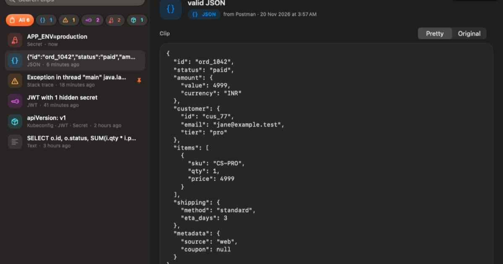
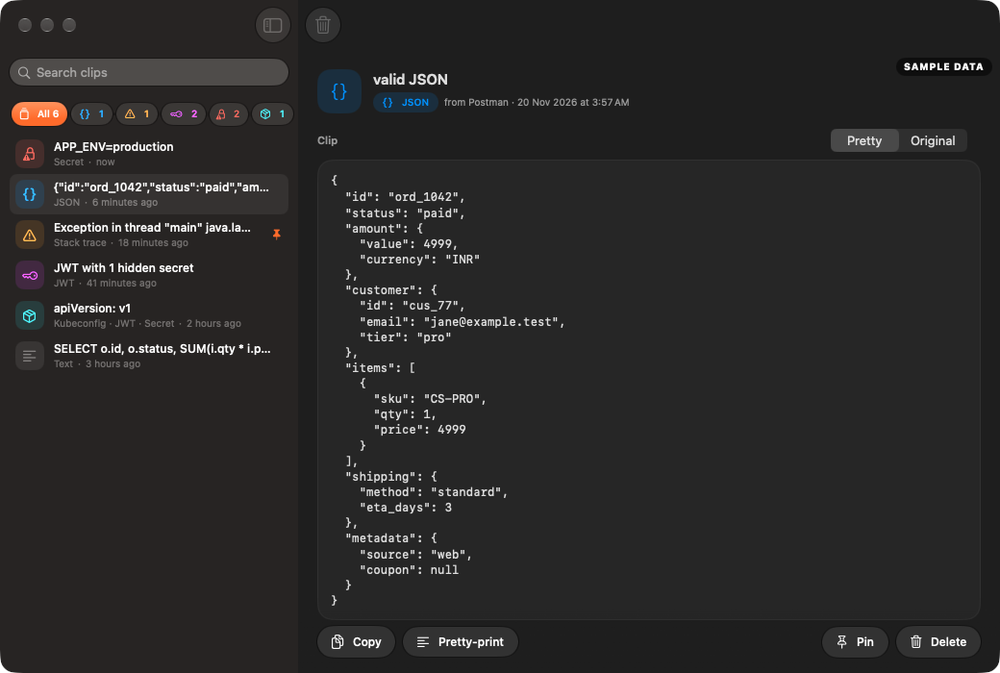
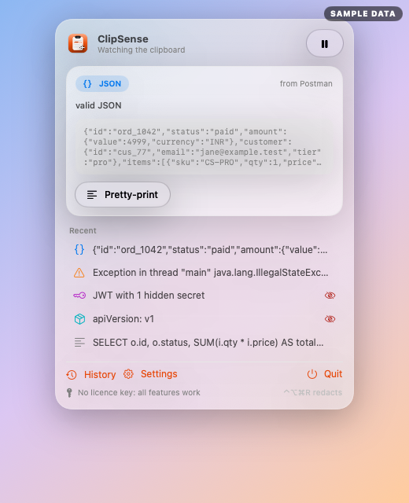

# ClipSense

### The clipboard that knows what you copied.

Recognises stack traces, JSON, kubeconfigs, secrets and JWTs and redacts, pretty-prints or decodes them in one click. Encrypted history on your Mac, no network entitlement.

 

**[Download the 30-day trial](https://github.com/zyvorai/clipsense/releases/tag/v0.2.0)** &nbsp;·&nbsp; [Website](https://zyvorai.github.io/clipsense/) &nbsp;·&nbsp; [Docs](docs/INSTALL.md) &nbsp;·&nbsp; Trial keys: [sales@zyvor.dev](mailto:sales@zyvor.dev?subject=ClipSense%20trial%20key)

`ClipSense-0.2.0.dmg` · macOS 27 or later · Apple silicon · Developer ID signed and notarized

---

## Download (trial)

| | |
| --- | --- |
| **Get it** | [ClipSense 0.2.0](https://github.com/zyvorai/clipsense/releases/tag/v0.2.0): `ClipSense-0.2.0.dmg` (SHA-256 `9e7fcf271e334ab4699e8ccc806ca9d805099927c0db25fd7c970c1c5fee3980`) |
| **30-day trial key** | **sales@zyvor.dev**. Enter it under **Licence…**. You do not need a key to use the app. |
| **Requirements** | macOS 27 or later, Apple silicon |
| **Pricing** | INR 1,499 per Mac, one-time, incl. 18% GST in India and one year of updates (about US$15 excl. tax outside India). Teams of 5 or more Macs: INR 1,249 per Mac (about US$13 excl. tax), minimum 5 Macs (INR 6,245, about US$63), by invoice. Prices: INR incl. 18% GST in India; US dollars excl. tax elsewhere (VAT, GST or sales tax added where applicable). Pay online by UPI, card or netbanking; international cards work (charged in rupees). Orders of USD 5,000 or more and quotes are invoiced in USD through Skydo. Custom pricing: contact sales@zyvor.dev. Buy: [zyvor.dev/buy](https://zyvor.dev/buy#clipsense) (30-day trial first). |

## See it

*Real app windows rendered with invented sample data and fake secrets. Not captures of anyone's clipboard.*

| History | Menu bar |
| --- | --- |
|  |  |

## What it does

- **Recognises** stack traces, JSON, kubeconfigs, secrets and JWTs.
- **Acts**: redact, pretty-print, decode JWT, open a kubeconfig context in Terminal on a private copy. History keeps the original.
- **Skips concealed clips** from password managers; never reads them.
- **Encrypted history**: AES-256-GCM, key only in your Keychain; secret-bearing clips are not written to disk by default.
- **Checkable privacy**: `codesign -d --entitlements - /Applications/ClipSense.app` shows no entitlements (no network). It is not sandboxed. See [docs/PRIVACY.md](docs/PRIVACY.md).

## Limits

- macOS may show "Allow paste from other apps" when ClipSense first reads the pasteboard; if denied, it stops reading.
- Early release: beyond its automated self-tests, the interactive click-through, the pasteboard prompt, VoiceOver and a clean-Mac install have not been tested by us.

## Trial and licence

30-day trial key: sales@zyvor.dev. Without a key, or after a trial, no data is lost; a commercial license is required for production use. Paid licences: INR 1,499 per Mac, one-time, incl. 18% GST in India and one year of updates (about US$15 excl. tax outside India). Teams of 5 or more Macs: INR 1,249 per Mac (about US$13 excl. tax), minimum 5 Macs (INR 6,245, about US$63), by invoice. Buy: [zyvor.dev/buy](https://zyvor.dev/buy#clipsense). Licensed under the [Zyvor Production Licence v2.0](LICENSE); see [NOTICE](NOTICE) and [docs/LICENSING.md](docs/LICENSING.md).

**The ClipSense source code is private.** This repository holds documentation, website and downloads.

Copyright © 2026 Zyvor AI Labs Private Limited · [zyvor.dev](https://zyvor.dev)
